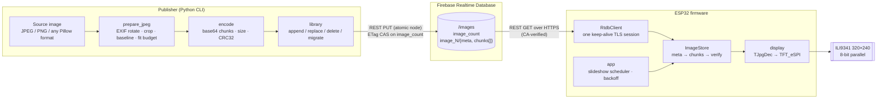
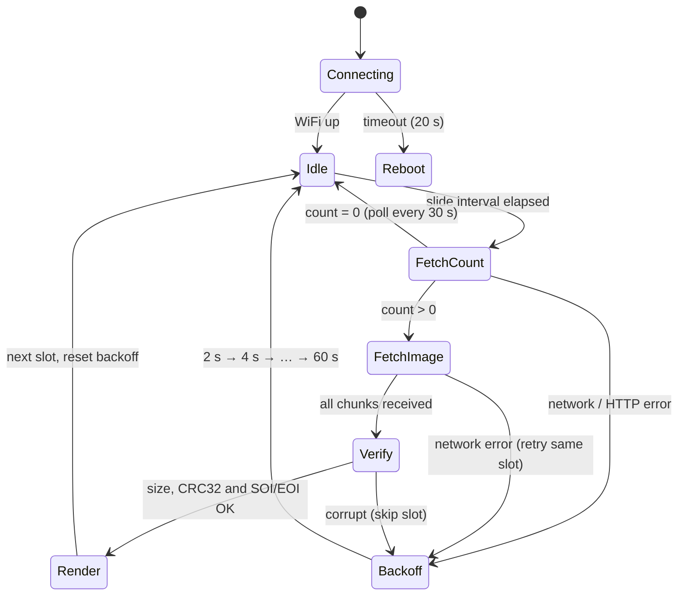
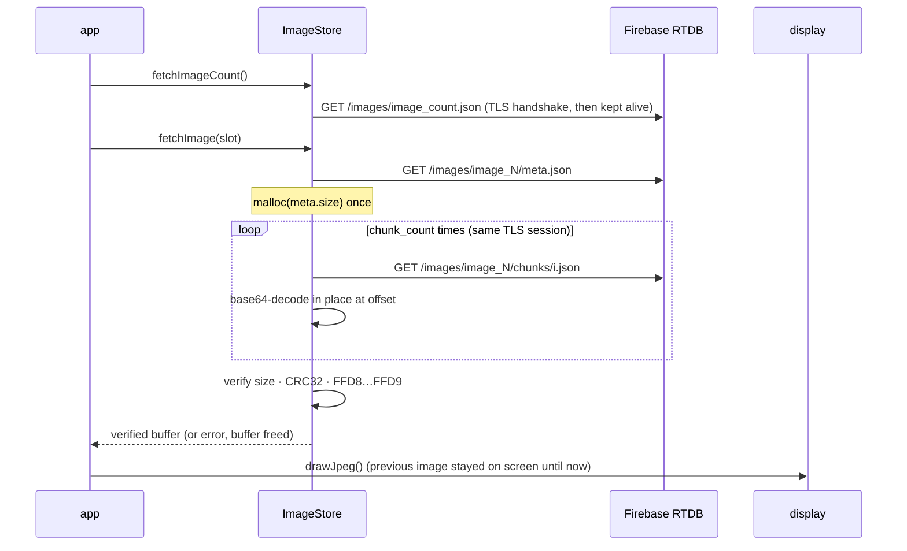
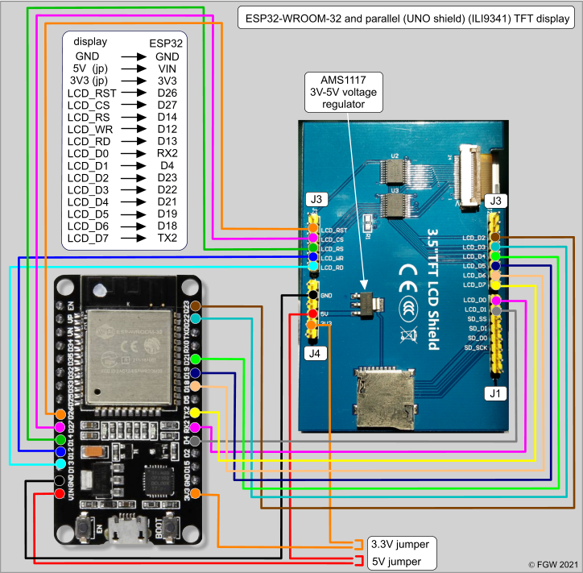

# InstaScreen

**A cloud-synced photo frame on a $5 microcontroller.** Images are published from a laptop, stored in Firebase Realtime Database as checksummed chunks, and streamed to an ESP32 that verifies, reassembles, and renders them on a 320×240 TFT. It has no backend server, no paid storage tier and no SD card.

[](https://github.com/cliffkoome/InstaScreen/actions/workflows/ci.yml)


[](LICENSE)

<p align="center">
  
</p>

---

## Contents

- [Problem and constraints](#problem-and-constraints)
- [System architecture](#system-architecture)
- [Data model and wire protocol](#data-model-and-wire-protocol)
- [Device runtime](#device-runtime)
- [Design decisions and trade-offs](#design-decisions-and-trade-offs)
- [Failure modes](#failure-modes)
- [Resource budget](#resource-budget)
- [Security model](#security-model)
- [Hardware](#hardware)
- [Getting started](#getting-started)
- [Testing strategy](#testing-strategy)
- [Limitations and roadmap](#limitations-and-roadmap)

---

## Problem and constraints

The goal is to update what a wall-mounted display shows from anywhere, without running a server.

| Constraint | Consequence for the design |
|---|---|
| **~320 KB SRAM, no PSRAM** on an ESP32-WROOM-32. TLS alone takes roughly 40–50 KB. | Images must be small and bounded. Every byte is budgeted (`kMaxImageBytes`), and the device never holds more than one image. |
| **TJpgDec decodes from a single in-memory buffer** and only handles baseline JPEG. | Images are fully reassembled before drawing. The publisher guarantees baseline encoding at the panel's exact resolution. |
| **Zero running cost.** Firebase Storage needs the paid Blaze plan; RTDB is free on Spark. | RTDB is used as a blob store, which means binary data has to be carried inside JSON. |
| **No server to own.** | All logic lives at the two edges: the publisher CLI and the firmware. Consistency comes from RTDB primitives (atomic node writes, ETag compare-and-set). |
| **Unattended operation.** | Every failure path ends in a bounded retry, and the display never shows a half-downloaded image. |

## System architecture



| Component | Responsibility | Code |
|---|---|---|
| **Publisher CLI** | Normalises arbitrary images into something the device can always decode, enforces the byte budget, and owns all playlist writes. | [`uploader/instascreen_uploader/`](uploader/instascreen_uploader) |
| **RTDB** | Durable store and the sole integration point. It has no custom backend and no Cloud Functions. | — |
| **`RtdbClient`** | HTTPS GET with a pooled TLS session, bounded response sizes, and typed outcomes (`Ok / Null / HttpError / Transport / TooLarge`). | [`rtdb_client.cpp`](firmware/InstaScreen/rtdb_client.cpp) |
| **`ImageStore`** | Format negotiation (v2 → v1 fallback), a single allocation, and integrity verification. It only ever returns a complete, verified JPEG or an error. | [`image_store.cpp`](firmware/InstaScreen/image_store.cpp) |
| **`codec`** | Pure, platform-independent base64/hex/CRC32/JPEG-marker logic, unit-tested on the host. | [`codec.cpp`](firmware/InstaScreen/codec.cpp) |
| **`app`** | A non-blocking scheduler: slide interval, WiFi lifecycle, and the retry policy. | [`app.cpp`](firmware/InstaScreen/app.cpp) |
| **`display`** | Panel and decoder setup, centred rendering, and status screens. | [`display.cpp`](firmware/InstaScreen/display.cpp) |

## Data model and wire protocol

```text
/images
├── image_count: 3                    ← playlist length; slots 1..image_count
├── image_1
│   ├── meta
│   │   ├── v:           2
│   │   ├── encoding:    "base64"
│   │   ├── size:        25439        ← exact JPEG byte length
│   │   ├── crc32:       2274207927   ← zlib/IEEE CRC-32 of the JPEG
│   │   └── chunk_count: 7
│   └── chunks: ["/9j/4AAQ…", "…", …] ← ≤ 4096 raw bytes each
├── image_2 …
```

**Invariants**

1. **`image_N` is always written with one PUT of the whole node.** RTDB applies that atomically, so a reader never sees `meta` from one image alongside `chunks` from another.
2. **`image_count` only changes through an ETag compare-and-set transaction** ([`rtdb.transaction`](uploader/instascreen_uploader/rtdb.py)).
3. **A slot in `1..image_count` may be briefly empty or invalid.** The device treats that as "skip", never as fatal. This is what lets the publisher use reserve-then-write ([ADR-0003](docs/adr/0003-reserve-then-write.md)).

**Versioning.** `meta.v` is the format version. Version 1 nodes, written by the original uploader, have no `meta`, only `chunk_count` plus hex chunks without a checksum. The firmware probes `meta` first and falls back to v1, so existing databases keep working through the upgrade. `instascreen migrate` rewrites v1 slots as v2 without re-compressing. The format is pinned from both ends: a fixture generated by the Python encoder is decoded by the firmware's C++ unit tests, and the same file is validated by the Python tests ([ADR-0002](docs/adr/0002-wire-format-v2.md)).

## Device runtime



One slide, from the device's point of view (v2):



## Design decisions and trade-offs

| Decision | Alternatives considered | Why | Cost accepted |
|---|---|---|---|
| **RTDB as the blob transport** ([ADR-0001](docs/adr/0001-rtdb-as-blob-transport.md)) | Firebase Storage; a self-hosted HTTP server; MQTT | Free tier, managed TLS and availability, a simple REST API, and nothing to operate. | Binary data has to travel as JSON strings. RTDB isn't designed for blobs, so this doesn't scale past a personal or small-fleet playlist. |
| **Chunked storage, 4 KB chunks** | One string per image; 1 KB chunks (v1) | Each chunk's HTTP body stays small, so the device never has a 40 KB `String` and the full image on the heap at once. 4 KB keeps an image to 3–8 requests. | More requests than a single blob. Chunk size is a tunable trade between peak heap use and round trips. |
| **base64 (v2) instead of hex (v1)** | Keep hex; raw binary via Storage | 1.33× overhead instead of 2×: about 33% less data on the wire and in RTDB. | A format migration, handled with in-firmware fallback and a `migrate` command. |
| **Integrity: size + CRC32 + JPEG markers** | Trust TLS; SHA-256 | TLS protects the transport, not a half-written or hand-edited node. CRC32 is cheap on an ESP32 and matches `zlib.crc32`. | CRC32 isn't cryptographic. That's fine because authenticity comes from TLS plus write-restricted database rules. |
| **Full-buffer decode** | Stream chunks straight into the decoder | TJpgDec reads from a memory buffer, and buffering lets nothing touch the screen until the image is verified. | Image size is capped by the largest free heap block, so the publisher enforces a 60 KB budget. |
| **Keep-alive TLS session** | New connection per request (v1) | The handshake dominates latency on the ESP32. Reuse means one handshake per slide instead of one per chunk. | The connection state has to be managed: the session is dropped after any transport error or WiFi loss. |
| **Polling on a slide interval** | RTDB streaming (SSE) for push updates | Simple and stateless, with no long-lived socket competing for the heap with downloads. | New uploads appear on the next cycle, not instantly. |
| **Pre-processing on the publisher** | Scaling and cropping on the device | A laptop has abundant CPU; the device gets exactly what it can render. | The publisher must know the panel geometry. It's a single constant, `PANEL_SIZE`. |
| **Reserve-then-write for appends** ([ADR-0003](docs/adr/0003-reserve-then-write.md)) | Write-then-publish | Two concurrent uploaders can never be handed the same slot. | A short window in which the device may see an empty slot, which it skips. |
| **CA-pinned TLS by default** | `setInsecure()` (v1) | Prevents a MITM on the network from serving arbitrary content to the device. | The Google Trust Services roots are bundled (valid until 2036) and must be refreshed if Google rotates them. |

## Failure modes

| Failure | Detection | Behaviour |
|---|---|---|
| WiFi drops | `WiFi.status()` before each cycle | The pooled TLS session is discarded, the driver auto-reconnects, and the loop backs off. The current image stays on screen. |
| WiFi unavailable at boot | 20 s connect timeout | Shows a status screen, then `ESP.restart()`. |
| Transport error mid-image | `HTTPClient` < 0 / empty body | The partial buffer is freed, the session reset, and the **same slot** retried with backoff. |
| Corrupt or truncated node | Size, CRC32 or SOI/EOI mismatch; missing chunk | The slot is skipped, the old image stays up, and the loop backs off. |
| Image larger than the budget | `meta.size` or growth past `kMaxImageBytes` | Rejected before allocating. The publisher prevents this up front. |
| Heap fragmentation / OOM | `malloc` returns `NULL` | The slot is skipped and the loop backs off. Nothing else is held across cycles. |
| Rules deny read / wrong host | HTTP 401/404 | Logged with the code, then backoff up to 60 s. |
| Empty playlist | `image_count` null or 0 | A "No images yet" screen, polled every 30 s. |
| Every slot bad | Repeated skips | Backoff grows to its cap instead of hot-looping. |
| Progressive JPEG published by another tool | `TJpgDec` returns an error | Treated as corrupt and skipped. |

## Resource budget

Measured on this repo's sample images and build. The device timings below are estimates, not benchmarks.

| Item | Value |
|---|---|
| Prepared image (320×240, baseline, q85) | **10–30 KB** across `uploader/samples/` (budget: 60 KB) |
| Requests per slide (v2, 4 KB chunks) | 1 count + 1 meta + **3–8 chunks**, over one TLS session |
| Requests per slide (v1, 1 KB hex chunks) | 1 + 1 + 10–30, each a **new TLS handshake** |
| Bytes on the wire per image | ~1.33 × JPEG size (v1: ~2×) |
| Firmware static RAM | 52 KB (15.9 %), from `pio run` |
| Firmware flash | 965 KB (73.6 % of the default 1.25 MB app partition) |
| Peak dynamic heap during a slide | one image buffer (≤ 60 KB) + one chunk body (≤ 8 KB) + the TLS session |

## Security model

| Threat | Mitigation |
|---|---|
| Anyone with the DB URL overwrites or deletes the playlist | Database rules make `/images` read-only to the public and writable only with auth. The CLI sends `FIREBASE_AUTH`. |
| MITM on the device's network serves arbitrary images | TLS with server-certificate validation against bundled GTS roots. Insecure mode needs an explicit build flag. |
| Credentials leaked via the repo | WiFi and DB settings live in `secrets.h` and `.env`, both gitignored. Only `*.example` templates are committed. |
| Malformed data crashes the device | All lengths are bounded (`kMaxChunkBodyBytes`, `kMaxImageBytes`). Decoders are overflow-checked and covered by unit tests. |

Recommended rules (**Realtime Database → Rules**):

```json
{
  "rules": {
    "images": {
      ".read": true,
      ".write": "auth != null"
    }
  }
}
```

For a private frame, set `.read` to `auth != null` as well and put a token in the firmware's `FIREBASE_AUTH`. Firebase has deprecated database secrets. For anything beyond a personal device, use short-lived Firebase Auth ID tokens, which the same `?auth=` parameter accepts.

## Hardware

| Part | Notes |
|---|---|
| ESP32-WROOM-32 DevKit | Any 38-pin DevKit with the same GPIO breakout |
| 2.4"/2.8" ILI9341 "UNO shield" TFT | 8-bit parallel bus, 320×240 |
| Jumper wires | 3.3 V / 5 V jumpers per the schematic |

<p align="center"></p>

| Display | ESP32 | | Display | ESP32 |
|---|---|---|---|---|
| LCD_RST | GPIO26 | | LCD_D0 | GPIO16 (RX2) |
| LCD_CS | GPIO27 | | LCD_D1 | GPIO4 |
| LCD_RS (DC) | GPIO14 | | LCD_D2 | GPIO23 |
| LCD_WR | GPIO12 | | LCD_D3 | GPIO22 |
| LCD_RD | GPIO13 | | LCD_D4 | GPIO21 |
| 5V | VIN | | LCD_D5 | GPIO19 |
| 3V3 | 3V3 | | LCD_D6 | GPIO18 |
| GND | GND | | LCD_D7 | GPIO17 (TX2) |

The same mapping is checked in as [`firmware/tft_setup/InstaScreen_ILI9341_Parallel.h`](firmware/tft_setup/InstaScreen_ILI9341_Parallel.h) for Arduino IDE users, and as build flags in [`platformio.ini`](platformio.ini). All data pins are below GPIO32, which TFT_eSPI requires because it writes the bus through a single GPIO register.

> **GPIO12 is a boot strapping pin (MTDI).** If the board fails to boot with the shield attached, the shield is probably holding GPIO12 high at reset, which selects 1.8 V flash. Burn the flash-voltage eFuse once with `espefuse.py set_flash_voltage 3.3V`, or move `LCD_WR` to another pin.

Wiring reference: Floris Wouterlood, [*ESP32 WROOM-32 and UNO shield parallel TFT displays*](https://thesolaruniverse.wordpress.com/2021/06/01/esp32-wroom-32-and-uno-shield-parallel-tft-displays/) (2021).

## Getting started

### 1. Firebase

1. Create a project and a **Realtime Database**. Copy its URL (`https://<id>-default-rtdb.<region>.firebasedatabase.app` or `…firebaseio.com`).
2. Apply the [rules above](#security-model).
3. For write access, use **Project settings → Service accounts → Database secrets** (simplest) or an ID token.

### 2. Publish images

```bash
cd uploader
python -m venv .venv && source .venv/bin/activate
pip install -e .
cp .env.example .env            # set FIREBASE_URL and FIREBASE_AUTH

instascreen upload ~/Pictures/*.jpg     # append to the playlist
instascreen upload cover.png --slot 2   # replace one slot
instascreen list                        # slot · format · size · chunks
instascreen delete 3                    # remove and compact
instascreen migrate                     # upgrade legacy v1 slots to v2
instascreen upload photo.png --dry-run  # validate without touching the DB
```

### 3. Flash the firmware

```bash
cp firmware/InstaScreen/secrets.example.h firmware/InstaScreen/secrets.h   # WiFi + DB URL
```

**PlatformIO (recommended):** library versions are pinned and the panel is configured through build flags.

```bash
pio run -e esp32dev -t upload && pio device monitor
```

**Arduino IDE:** open `firmware/InstaScreen/InstaScreen.ino`. Install **TFT_eSPI**, **TJpg_Decoder** and **ArduinoJson 7** from the Library Manager, then select the panel setup as described at the top of [`InstaScreen_ILI9341_Parallel.h`](firmware/tft_setup/InstaScreen_ILI9341_Parallel.h).

Timings and limits live in [`config.h`](firmware/InstaScreen/config.h). If you change `kMaxImageBytes`, pass the same value to `instascreen upload --max-bytes`.

## Testing strategy

| Layer | What is checked | How |
|---|---|---|
| Firmware core | base64/hex decoding (padding, JSON escapes, overflow), CRC-32 against the standard check value, JPEG markers, backoff policy | Unity tests on the host: `pio test -e native` |
| Wire-format contract | C++ decoders accept chunks produced by the Python encoder, and Python accepts the same fixture | Generated `fixture.h`, asserted from both suites |
| Firmware build | Compiles against pinned ESP32 core and libraries | `pio run -e esp32dev` in CI |
| Publisher | EXIF rotation, crop vs stretch, RGBA/palette input, quality fallback, round trip, corruption detection, v1 decode | `pytest` |
| Concurrency | Lost compare-and-set races retry; concurrent appends get distinct slots; deletes compact | In-memory RTDB fake with ETag semantics, plus HTTP-level tests with `responses` |
| On device | Boot shows slot 1 for the full interval; v1 data still renders; pulling WiFi mid-download keeps the old image and backs off | Manual hardware checklist |

CI runs all automated layers on every push and pull request ([`.github/workflows/ci.yml`](.github/workflows/ci.yml)).

## Limitations and roadmap

- **Scale:** RTDB as a blob store suits one frame and a modest playlist. A fleet would move images to object storage behind signed URLs and keep RTDB for the manifest only.
- **Latency:** polling means updates appear on the next cycle. RTDB's SSE stream on `image_count` would push changes instead, at the cost of a long-lived socket.
- **Memory ceiling:** full-buffer decoding caps image size. A PSRAM module (ESP32-WROVER) would allow higher-quality images, or a double-buffered crossfade.
- **Operations:** no OTA updates or remote telemetry yet. Next steps are ArduinoOTA plus a heartbeat node (`/devices/<mac>/last_seen`, free heap, RSSI).
- **Power:** always on. A deep-sleep schedule (e.g. off overnight) is a natural extension of the scheduler.

## Repository layout

```text
firmware/InstaScreen/   ESP32 sketch (Arduino IDE and PlatformIO)
firmware/test/          host-side Unity tests + generated wire-format fixture
firmware/tft_setup/     TFT_eSPI pin configuration for Arduino IDE
uploader/               instascreen CLI (Python package + tests)
docs/                   schematic and architecture decision records
platformio.ini          pinned toolchain and libraries
```

## License

MIT. See [LICENSE](LICENSE).
